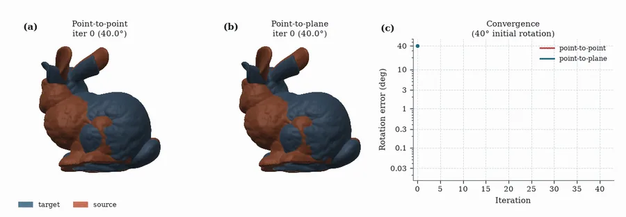
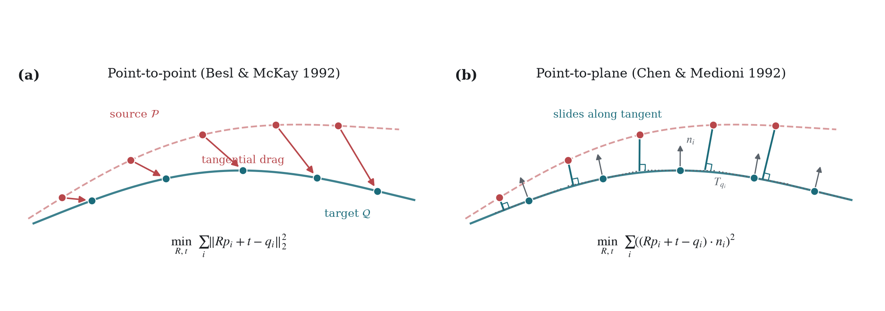
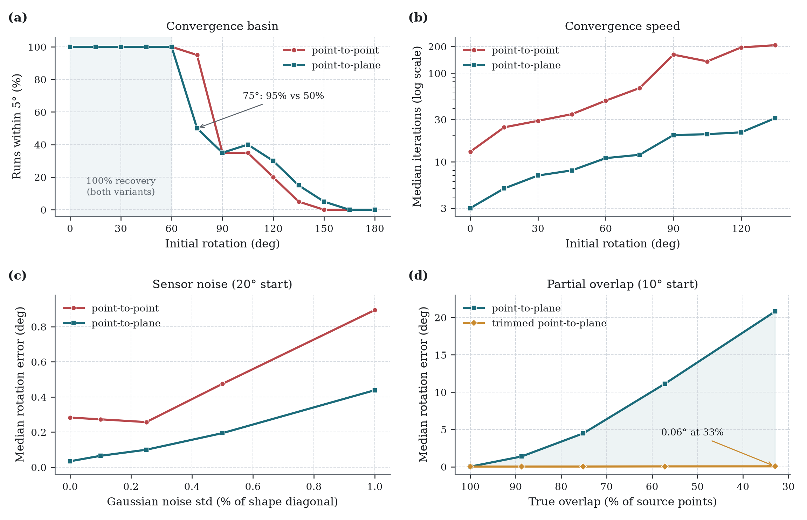
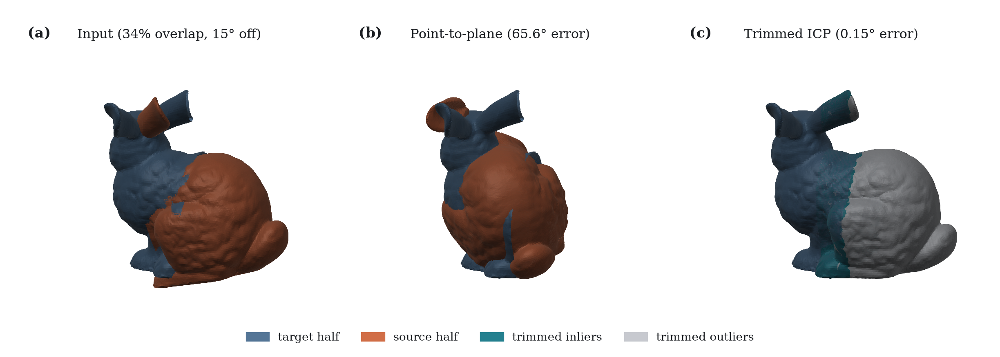

# Mesh-Cloud-Toolkit

Point cloud registration from scratch in NumPy and SciPy.

<p align="center">
  
</p>
<p align="center"><sub>Two independent 4,000 point samplings of the Stanford Bunny, 40 degrees apart. Point-to-plane converges in 8 iterations (0.03 deg) against 42 for point-to-point (0.14 deg).</sub></p>

## Formulation

<p align="center">
  
</p>

Each step matches each source point $p_i$ to its nearest target point $q_i$, keeps the closest $\alpha$ fraction when $\alpha < 1$, and solves either the closed-form Procrustes step (Besl and McKay 1992, Umeyama 1991) or the linearized tangent-plane step (Chen and Medioni 1992).

$$\min_{R \in SO(3),\, t} \sum_{i \in \mathcal{I}} \|R p_i + t - q_i\|_2^2 \qquad \text{vs.} \qquad \min_{R \in SO(3),\, t} \sum_{i \in \mathcal{I}} \bigl((R p_i + t - q_i)\cdot n_i\bigr)^2$$

## Benchmarks

Two independent 4,000 point samplings of the Stanford Bunny, 20 random runs per point (`results/`).

<p align="center">
  
</p>

| Experiment | Point-to-point | Point-to-plane | Trimmed point-to-plane |
|---|---|---|---|
| 0 to 60 deg start | 100% ok, 13 to 49 it, 0.22 to 0.29 deg | 100% ok, 3 to 11 it, 0.03 deg | - |
| 75 deg start | 95% ok, 68 it | 50% ok, 12 it | - |
| 1% Gaussian noise (20 deg) | 0.89 deg median | 0.44 deg median | - |
| 33% overlap (10 deg) | - | 0% ok, 20.80 deg | 100% ok, 0.06 deg |

## Partial overlap

<p align="center">
  
</p>
<p align="center"><sub>Two halves sharing 34% of the surface, 15 degrees apart. Plain point-to-plane is pulled to 65.6 deg error by unmatched points while trimmed ICP holds 0.15 deg.</sub></p>

## Modules

| Module | What it does |
|---|---|
| `meshcloud.io` | ASCII and binary PLY and OBJ readers and writers |
| `meshcloud.sampling` | Area-weighted triangle sampling over a mesh surface |
| `meshcloud.normals` | Surface normals by PCA over k nearest neighbors |
| `meshcloud.icp` | Point-to-point, linearized point-to-plane, distance rejection and trimming |
| `meshcloud.transform` | Rotations, 4x4 transforms and rotation error metrics |

## Install and use

```bash
pip install git+https://github.com/samehaisaa/Mesh-Cloud-Toolkit
```

Command line

```bash
meshcloud sample bunny.ply -n 20000 -o target.ply
meshcloud register source.ply target.ply --method point-to-plane --overlap 0.6 -o aligned.ply
```

Python

```python
from meshcloud import icp, read_points

source, target = read_points("source.ply"), read_points("target.ply")
result = icp(source, target, method="point-to-plane", overlap=0.6)
```

## Reproduce

```bash
pip install -e ".[dev]"
pytest
python experiments/fetch_bunny.py
python experiments/basin.py
python experiments/robustness.py
python experiments/diagrams.py
python experiments/animate.py
```

## References

- P. J. Besl and N. D. McKay. A method for registration of 3-D shapes. IEEE TPAMI 14(2):239-256, 1992. [doi:10.1109/34.121791](https://doi.org/10.1109/34.121791)
- Y. Chen and G. Medioni. Object modelling by registration of multiple range images. Image and Vision Computing 10(3):145-155, 1992. [doi:10.1016/0262-8856(92)90066-C](https://doi.org/10.1016/0262-8856(92)90066-C)
- S. Umeyama. Least-squares estimation of transformation parameters between two point patterns. IEEE TPAMI 13(4):376-380, 1991. [doi:10.1109/34.88573](https://doi.org/10.1109/34.88573)
- D. Chetverikov, D. Svirko, D. Stepanov and P. Krsek. The Trimmed Iterative Closest Point algorithm. ICPR 2002, vol. 3, pp. 545-548. [doi:10.1109/ICPR.2002.1047997](https://doi.org/10.1109/ICPR.2002.1047997)
- R. Osada, T. Funkhouser, B. Chazelle and D. Dobkin. Shape distributions. ACM Transactions on Graphics 21(4):807-832, 2002. [doi:10.1145/571647.571648](https://doi.org/10.1145/571647.571648)

Stanford Bunny mesh from the Stanford 3D Scanning Repository.

## License

MIT
